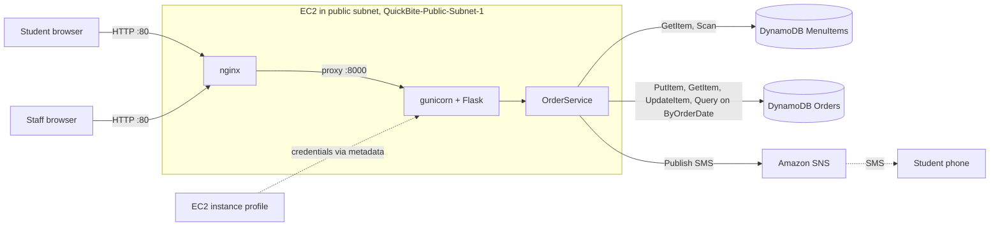

# QuickBite Architecture

## Components

| Component | Where it runs | Responsibility |
|---|---|---|
| Student and staff browsers | User devices | Render pages, keep the cart in localStorage, call the JSON API |
| nginx | EC2 (port 80) | Public entry point; forwards requests to gunicorn |
| gunicorn + Flask | EC2 (127.0.0.1:8000) | Pages, JSON API, staff session, business rules |
| `OrderService` | Inside Flask | Validation, server-side pricing, order IDs, status rules, notifications |
| DynamoDB `QuickBite-MenuItems` | AWS | Menu |
| DynamoDB `QuickBite-Orders` | AWS | Orders and student history, with `ByOrderDate` and `ByStudentPhone` indexes |
| DynamoDB `QuickBite-Students` | AWS | Student accounts and unique phone/college-ID lookup records |
| Amazon SNS | AWS | SMS delivery to student phones |
| IAM role `QuickBite-EC2-Role` | AWS | Grants the instance only the permissions it needs |
| VPC, public subnet, IGW, route table, security group | AWS | Network and firewall |

## Diagram



## Network

- VPC `QuickBite-VPC` (10.0.0.0/16) with DNS support and DNS hostnames enabled.
- `QuickBite-Public-Subnet-1` (10.0.1.0/24) auto-assigns public IPv4 addresses and holds the EC2 instance.
- `QuickBite-Subnet-2` (10.0.2.0/24) is created but unused in this version.
- The internet route (0.0.0.0/0 to the Internet Gateway) in `QuickBite-Public-RT` is what makes the subnet public. A subnet is "public" only when its route table has a route to an Internet Gateway. A private subnet has no such route and needs a NAT gateway for outbound internet access. None is created, to avoid NAT charges.

## Data flow

**Placing an order**
1. A student creates an account or logs in with the matching name and phone number. The backend stores accounts in SQLite in demo mode and DynamoDB in AWS mode.
2. The browser posts item IDs and quantities to `POST /api/orders`. Any customer details or price it sends are ignored.
3. `OrderService` uses the logged-in account and normalises its phone to E.164.
4. It loads the menu from the database, rejects unknown or unavailable items, and computes each line total and the order total.
5. It generates an order ID (`QB-<year>-<8 hex>`), records the user ID, selected payment method and `Pay at pickup` payment status, then writes the order with `status=Placed`.
6. It sends the "placed" SMS. If SNS fails, the order is still saved and the response reports `notification: failed`.
7. The browser clears its cart and opens the confirmation page.

**Tracking**
The tracking page calls `GET /api/orders/<id>` every 20 seconds. Completed orders are hidden from student-facing endpoints. The response includes status, items, total and timestamps, but never the phone number.

The account page calls `GET /api/student/orders` to show the student's full order history, including Completed orders and payment status. In demo mode it uses the SQLite user/date index; in AWS mode it queries `ByStudentPhone`.

**Staff update**
The dashboard loads `GET /api/staff/orders` and `/api/staff/menu` every 5 seconds. Clicking an order action sends `PATCH /api/staff/orders/<id>/status`; menu edits use `/api/staff/menu`. The server checks that each order move is exactly one step forward and performs a conditional update on the current status. It sends the Ready SMS when the order reaches Ready for Pickup.

Staff payment updates use `PATCH /api/staff/orders/<id>/payment`; new orders start as Pay at pickup, and staff can mark them Paid when payment is received.
Checkout stores the selected payment preference (`counter` or `online`), but no online payment is processed. Both payment methods are settled at the canteen counter at pickup.

## Order lifecycle

```
Placed ──► Preparing ──► Ready for Pickup ──► Completed
  │             │                 │
  │             │                 └─ Ready SMS sent here
  └─ placed SMS sent at checkout
```

Only forward moves are allowed. Completed is final and hidden from student tracking. Students have no endpoint that changes status.

## Staff flow

Staff log in at `/staff/login` (password checked against `STAFF_PASSWORD_HASH`). Orders and menu management require a staff session. Student accounts use the backend store and a persistent session cookie.

## Demo mode

`APP_MODE=demo` swaps DynamoDB for `DemoStore` (SQLite) and disables SMS unless `SNS_ENABLED=true` is set explicitly. The application code above the storage layer is identical in both modes. The yellow banner makes the mode visible to anyone using the app.
